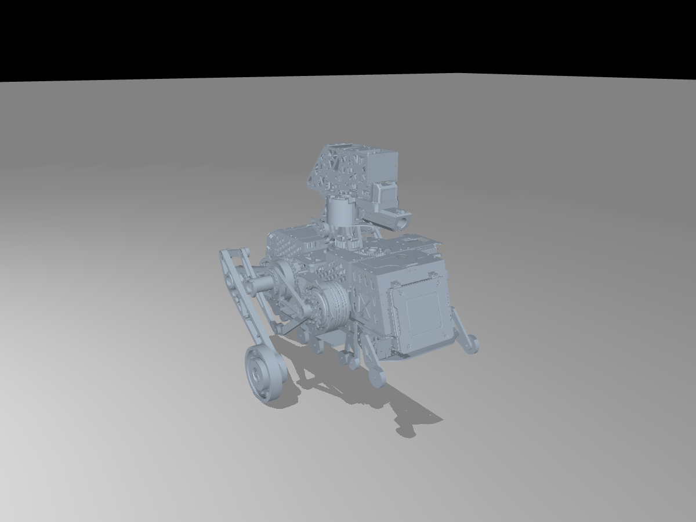

# 完整 CAD 模型接入验证（2026-11-13）

<a id="scope"></a>

## 本轮范围

按用户指定组合 `series_legged` 连杆几何、`series_legged2` 云台/双 IMU/transmission/腿部限制、`serial_leg_complete` 惯性与外观。加入用户给出的等效弹簧力曲线，接入原 yaw/pitch 控制器，不驱动拨弹/摩擦轮。所有实现变更位于 `rm_mujoco`，控制器物理参数、Q/R/PID 与 Manual 源码保持现值。

读取时各仓库 HEAD：`rm_description` 为 `8934150`、`rm_controllers` 为 `8e02654`、`rm_config` 为 `b610f67`、`mujoco_ros_pkgs` 为 `aadba63`；这些仓库已有用户修改，以磁盘文件为输入。`rm_mujoco` 无独立 Git 仓库。机械输入摘要见 [source_manifest.json](../models/series_legged2/source_manifest.json)。

<a id="offline"></a>

## 离线检查与构建

| 检查 | 结果 |
|---|---|
| 原始完整 CAD 副本 | 109 个原始文件仍与复制清单 SHA-256 一致 |
| 新模型加载 | MuJoCo 3.3.5；36 bodies（含 world/辅助 frame）、68 geoms、62 meshes |
| 自由度与接口 | `nq=23`、`nv=22`、17 joints（含 freejoint）、0 native actuators、4 equality；8 effort + 8 passive state |
| 总质量 | 30.911130235045 kg；17 个 CAD 刚体质量逐个保留 |
| 惯量变换 | 每个变换的旋转行列式为 +1；惯量主值最大变化约 $1.11\times10^{-16}$ kg·m² |
| 初始闭链 | 实际腿长 0.20 m；MuJoCo equality 位置残差最大约 $5.55\times10^{-17}$ m |
| 生成器复现 | 再生成的 MJCF、URDF、初态文件 SHA-256 不变 |
| launch 展开 | 普通与 `manual:=true` 两种参数展开通过；两者都加载弹簧和 ROS 控制插件、双 IMU |
| 相关构建 | `rm_mujoco`、原 `rm_gimbal_controllers` 构建通过 |
| 自动检查 | 旧硬件回归 1 项、新完整模型 3 项，共 4 项通过 |

新测试见 [complete_model_test.cpp](../tests/complete_model_test.cpp)：

1. 校验质量、闭链、关节限制、初始腿长与双 IMU 外参。
2. 校验八路 effort/十六路 state、双 IMU 读回、腿部 ±40 N·m 限制与各独立命令通道。
3. 用用户力曲线的势能数值梯度，独立检查弹簧广义力的方向和大小；检查浮动基座的净内部作用为零、原有被动力未被覆盖、电机输入保持零。

相关命令：

```bash
source ./mujoco_env.sh
catkin build rm_mujoco rm_gimbal_controllers --no-deps --no-status -j2 -p1
catkin build rm_mujoco --no-deps --no-status -j2 -p1 --make-args hardware_interface_test complete_model_test
rostest rm_mujoco hardware_interface.test
rostest rm_mujoco complete_model.test
```

测试结果位于工作区 `build/rm_mujoco/test_results/rm_mujoco/`。静态预览仅执行 `mj_forward`，未将画面作为力矩或动作证据：



<a id="runtime"></a>

## 短时 ROS 接入检查

使用独立 `ROS_MASTER_URI=http://127.0.0.1:11329`，启动自有 roscore 和 headless、初始暂停的 `series_legged.launch`。通过官方 step action 推进到约 **0.446 s**，结束后关闭本次启动的进程；未连接实机或用户 11311 master。

有效记录在工作区 `logs/mujoco_integration/20261113_complete/sim_clock/`：`server.log`、`smoke.log`、`quick_smoke.json`。脚本为 [ros_smoke.py](../tests/ros_smoke.py) 的 `--quick` 模式。

- joint_state、robot_state、chassis、gimbal 四个控制器均为 `running`，底盘与云台共声明八个目标关节资源。
- 弹簧插件成功加载，原 gimbal controller 获得 `gimbal_imu`。
- 分别发送 RAW 零速、0.1 m/s 短平移、yaw 0.1 rad/s、pitch 0.05 rad/s、FALLEN 命令；命令时间戳使用 ROS 仿真时钟。
- 收到 16 个关节状态。该段 yaw 位置范围约 [1.570526, 1.580501] rad，pitch 约 [0.000127, 0.003026] rad。包含机体耦合运动，未据此判定跟踪误差或方向性能合格。
- 底盘 stop/start 服务切换成功；云台保持运行。
- Mode 消息出现 SIT_DOWN → STAND_UP → NORMAL，随后 SIT_DOWN。初始腿已展开，STAND_UP 阶段很短，这不证明从坐姿物理起立成功。
- 记录了 20 次模型 body 状态和 40 条兼容底盘状态。body 查询位置/四元数有限；短测涵盖控制和坐下阶段，不用于稳定保持评价。

兼容状态、JointState 和服务查询分别保留各自时间，未拼成同拍真值。`qfrc_applied` 的 effort 读回不包含弹簧/接触反力，不当作实测电机力矩。没有服务扶正、接触改写或修改控制器内部标志。

首轮脚本在 `/use_sim_time` 参数建立前初始化 rospy，使用了墙钟时间戳。该轮原始日志保留在 `logs/mujoco_integration/20261113_complete/` 根目录，**不作为有效动作证据**。脚本已改为等待仿真时钟配置，并等待 action 完成回调后再发送下一步；上述 `sim_clock/` 为修正后的独立运行。

运行日志仍有 KDL 根链接惯量提示、原 dynamic_reconfigure mutex 提示；退出时 spawner 随 server 关闭出现服务传输提示。没有修改公共框架处理这些既有行为。

<a id="manual"></a>

## Manual 加载

在另一个独立 11329 会话加载 `manual:=true`，只推进约 0.037 s，未发送 DBUS 输入。joint_state/robot_state 为 `running`，chassis/gimbal 为 `initialized` 等待原 Manual 启动。日志位于 `logs/mujoco_integration/20261113_complete/manual_load/`。原 YAML 的功率阈值、`follow_source_frame`、`chassis_motor` 等缺参仍打印 ERROR；本次未补造配置。未加载 shooter 或校准控制器，未作遥控器/键鼠动作验收。

<a id="limits"></a>

## 已知差异与未覆盖项

CAD 长杆与指定 URDF 铰点间距相差约 0.51 mm；运动学按 URDF，原网格和惯量不缩放。实际 0.20 m 竖直腿在现有 VMC 中得到约 0.198175918 m 和 −0.006483476 rad；详见 [模型说明](../models/series_legged2/README.md)。

用户明确保留控制器的原物理参数，因此仿真机械与 LQR 名义模型存在参数失配。本轮验证模型和接口接入，没有验收持续站稳、起立成功率、运动跟踪、跳跃或实机性能。弹簧是指定曲线的等效轴向模型；碰撞包络和摩擦沿用模型来源，没有进行接触参数辨识。
